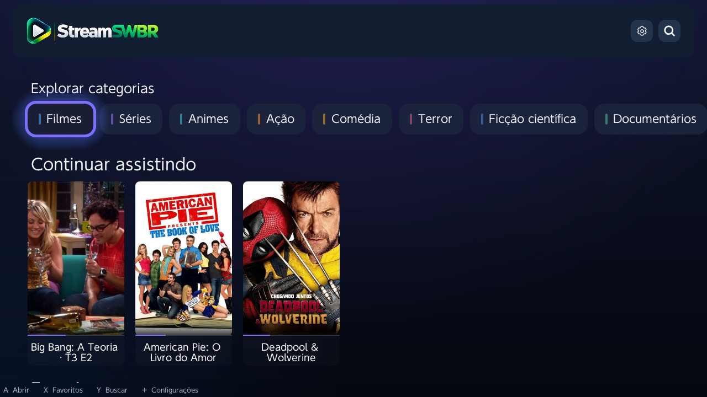
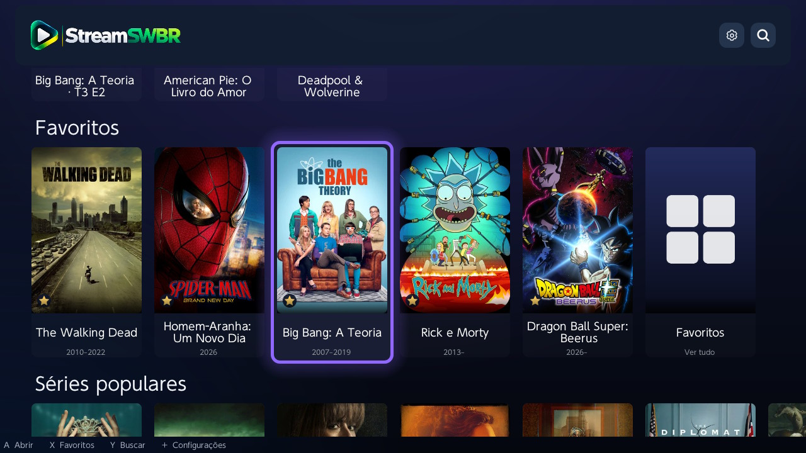
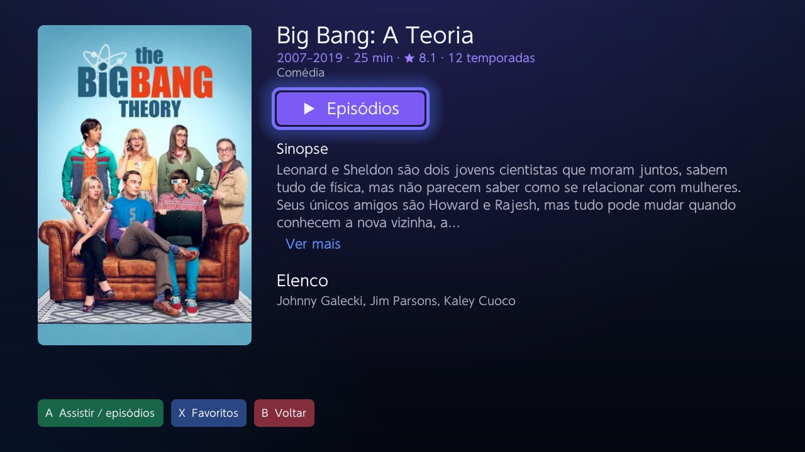
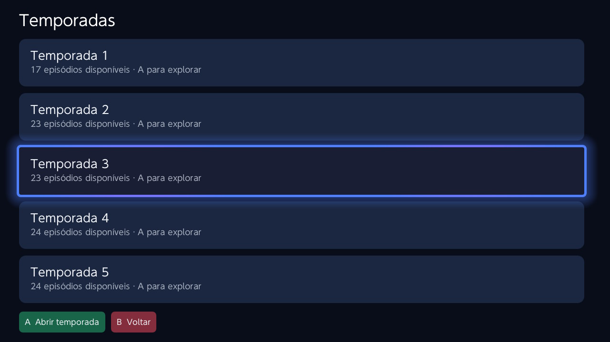
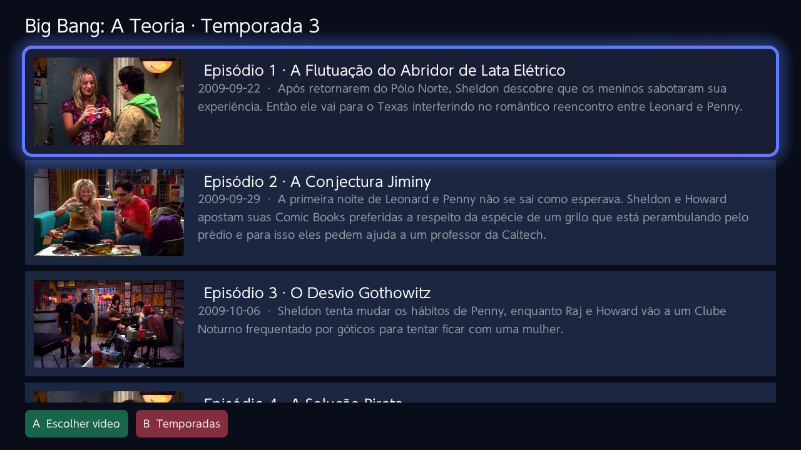
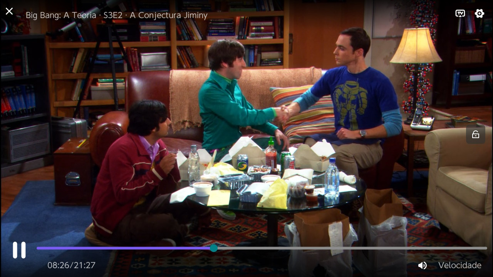

<p align="center">
  
</p>

# Stream SWBR

**Seus filmes e séries no Nintendo Switch, com uma interface em português.**

Stream SWBR é um aplicativo homebrew para Nintendo Switch que reúne filmes, séries e animes em uma interface organizada, com navegação pelo controle, favoritos e acompanhamento do que você está assistindo.

## Recursos

- **Interface em português**, com títulos, sinopses e informações dos episódios conforme a disponibilidade das traduções.
- **Continuar assistindo**, com progresso salvo e retomada pela última fonte utilizada.
- **Favoritos**, para guardar seus filmes e séries.
- **Próximo episódio automático**, com aviso nos últimos 30 segundos ele muda para o próximo episódio ou toque no aviso para mudar.
- **Categorias organizadas**, com filmes, séries, animes e gêneros.
- **Temporadas e episódios** com imagens, títulos e descrições.
- **Busca integrada** e opções para personalizar a tela inicial.
- **Gerenciamento de complementos de vídeo** e preferência de fonte.

## Conheça o aplicativo

### Tela inicial

Categorias e continuar assistindo.



### Favoritos

Seus títulos salvos.



### Detalhes

Sinopse, elenco e informações da obra.



### Temporadas

Organização das séries.



### Episódios

Imagens e descrições.



### Reprodução

Controles do player.



## Download e instalação

Baixe a versão mais recente em [Releases](https://github.com/zDSiilva/StreamSWBR/releases/latest).

Extraia o ZIP e copie a pasta `switch` para a raiz do cartão SD. O aplicativo ficará em:

```text
switch/Stream-SWBR/Stream-SWBR.nro
```

Abra pelo HB Menu, preferencialmente em modo aplicativo, segurando **R** ao iniciar um jogo.

**Para atualizar:** substitua somente o arquivo `Stream-SWBR.nro`, mantendo o nome e a pasta. Seus favoritos, histórico e configurações serão preservados.

## Complementos de vídeo

O Stream SWBR reproduz vídeos disponibilizados por complementos compatíveis com o protocolo Stremio. A versão atual vem com o FenixFlix configurado, e você pode gerenciar outros endereços nas configurações.

O aplicativo não hospeda filmes ou séries. A disponibilidade dos vídeos, idiomas e qualidades depende dos serviços utilizados.

## Créditos

Personalização, identidade visual e edição: **[Diguit](https://x.com/digsva)**.

Baseado em [StreamFinEX, de Kirbosh](https://github.com/Kirbosh/StreamFinEX), [StreamFin, de scamNscoot](https://github.com/scamNscoot/StreamFin) e [Switchfin, de dragonflylee](https://github.com/dragonflylee/switchfin). Agradecimentos aos autores e colaboradores originais, com licenças e avisos de autoria preservados.

Dados de filmes e séries fornecidos pelo **TMDB**, via **TMDB Addon / ElfHosted**.

*This product uses the TMDB API but is not endorsed or certified by TMDB.*
